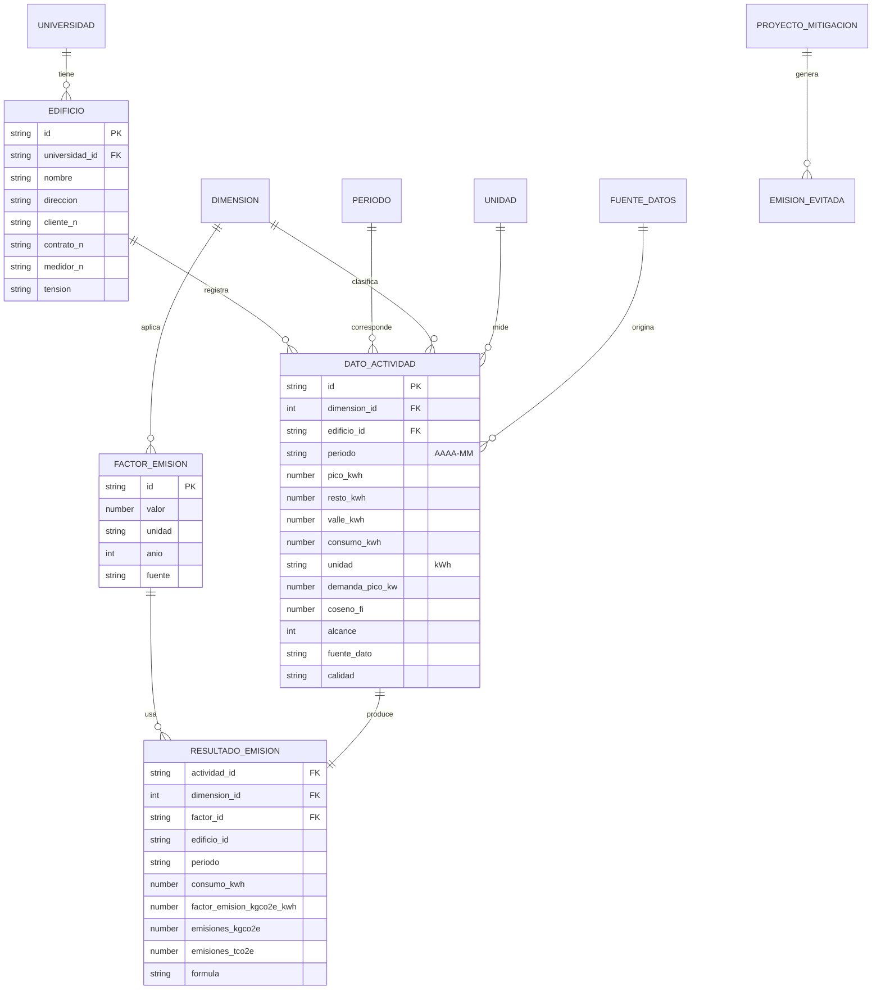

# Documentación técnica y metodológica · Energía eléctrica (Grupo 1)

## 1. Investigación realizada

**Qué se investigó**
- Cómo se factura la electricidad de grandes usuarios de EPEC (tarifa 3GDES): demanda de potencia (kW) y energía (kWh) por franja pico, resto y valle.
- Qué factor de emisión corresponde a la red eléctrica argentina y quién lo publica.
- Cómo evolucionó la tarifa de EPEC entre septiembre de 2025 y septiembre de 2026, para contextualizar el costo.
- Qué significan los alcances 1, 2 y 3 del GHG Protocol y cuál corresponde a la electricidad.

**Conclusión metodológica:** la electricidad comprada a la red es **Alcance 2**. Las emisiones se calculan con el consumo en kWh y no dependen de la tarifa en pesos. Los aumentos de EPEC afectan el costo, no las toneladas.

## 2. Metodología

1. Se releva cada factura mensual de EPEC por suministro.
2. Se cargan los kWh de pico, resto y valle, la demanda y el coseno φ.
3. Se obtiene el factor de emisión (de la API central; si no está disponible, el local de referencia).
4. Se calcula `CO2e = kWh × FE` y se convierte a toneladas.
5. Se guarda la traza de cada cálculo (valores de entrada, factor, fuente y fórmula).
6. Se elige el año del inventario (año calendario) y se agregan los resultados de ese año por edificio, mes y franja. Se calculan los indicadores y la cobertura: cuántos de los 12 meses tiene cada suministro.

Detalle de variables y fórmulas: `01-modelo-de-medicion.md`.

## 3. Fuentes de información

| Dato | Fuente | Estado |
|---|---|---|
| Consumo, demanda, coseno φ, importes | Facturas EPEC de agosto 2024 (dos suministros), publicadas por la facultad | Real, transcripto de imagen |
| Factor de emisión oficial | SNIGEIAR, *Factores de Emisión GEI 2025*, Tabla 5: **0,283 kgCO₂e/kWh** (año 2022) | Oficial, pero de 2022 |
| Factor de emisión de referencia | Ember, vía carbonrecycling.co.uk: **0,343 kgCO₂e/kWh** (año 2025) | Tercero, no oficial |
| Aumentos de tarifa EPEC | Gobierno de Córdoba (nota de prensa citada por Perfil, 15/10/2026), El Doce, Cadena 3, Derecha Diario | Parcial, ver sección 9 |

Enlaces:
- SNIGEIAR: https://inventariogei.ambiente.gob.ar/files/Factores_de_Emision_SNIGEIAR_para_HC_2025.pdf
- Factor Ember: https://carbonrecycling.co.uk/es/emission-factors/electricity/argentina
- Evolución tarifaria 2026: https://www.perfil.com/noticias/cordoba/epec-para-la-provincia-los-aumentos-dispuestos-por-nacion-fueron-el-principal-factor-de-la-suba-de-la-tarifa.phtml
- Ajustes mensuales 2025 (FAM): https://eldoce.tv/actualidad/2025/11/03/autorizaron-una-suba-de-la-energia-cuanto-aumentara-epec/

## 4. Supuestos

1. Cada suministro de EPEC corresponde a un edificio de la facultad. **Falta confirmar la asignación** (ver sección 9).
2. El consumo del mes facturado representa el consumo del mes calendario.
3. Se usa el factor promedio de la red (método basado en ubicación).
4. El factor 0,283 se toma como kgCO₂e/kWh, es decir, con CO₂, CH₄ y N₂O incluidos, según la nota al pie de la Tabla 5 de SNIGEIAR ("incluye emisiones de CO2, CH4 y N2O calculadas con AR5"). **Hay una ambigüedad:** en esa tabla la columna dice "kg CO2/kWh" y el CH₄ (0,0000167 kg/kWh) y el N₂O (0,0000097 kg/kWh) aparecen en columnas aparte. Si el 0,283 fuera solo CO₂, sumando CH₄ × 28 y N₂O × 265 (PCG AR5) quedaría **0,2860 kgCO₂e/kWh** (+1,1 %: 34,38 t en lugar de 34,02 t en el relevamiento base). A confirmar con la cátedra.
5. No hay generación propia ni compra de energía renovable certificada.
6. Los valores de las facturas de 2024 se usan como relevamiento base; el inventario anual real requiere facturas de los 12 meses.
7. El año del inventario es el año calendario (enero a diciembre).
8. Un "edificio" del módulo es en realidad un **suministro** de EPEC (un medidor). Ciudad Universitaria es un solo suministro para todo el campus: el consumo no se puede separar por edificio físico sin submedidores. Si otros grupos usan edificios físicos, hay que acordar con la cátedra cómo se relacionan.

## 5. Modelo de datos

El modelo concreto es el archivo `data/energia_electrica_grupo1.json`. Sigue las entidades mínimas que pidió la cátedra para la base central.

### Diagrama entidad-relación



`PROYECTO_MITIGACION` y `EMISION_EVITADA` existen en la base central pero este módulo no los usa.

Relación con las entidades centrales:
- **Universidad** y **dimensión**: claves `universidad_id` (en edificios) y `dimension_id` (en datos de actividad y resultados). Todo lo que se envía a la API lleva las dos.
- **Período**: `periodo` se guarda como texto `AAAA-MM`; el período anual de la base central es su año.
- **Unidad** y **fuente de datos**: se guardan como texto (`kWh`, "Factura EPEC…"). Si la base central usa identificadores, se reemplazan por esas claves al conectar la API.
- **Factor de emisión**: cada resultado guarda `factor_id` y el valor aplicado.

### Diccionario de datos

**edificios**

| Campo | Tipo | Descripción |
|---|---|---|
| id | texto | Identificador, p. ej. `EDI-FRC-01` |
| universidad_id | texto | Referencia a universidades (`UTN-FRC`) |
| nombre / nombre_corto | texto | Nombre completo y abreviado |
| direccion | texto | Dirección del suministro |
| distribuidora | texto | `EPEC` |
| cliente_n / contrato_n | texto | Números de cliente y contrato de la factura |
| medidor_n | texto | Número de medidor. Vacío hasta leerlo en la factura original |
| tension | texto | Media o baja tensión |
| tarifa | texto | Tarifa de la factura (3GDES) |

**datos_actividad**

| Campo | Tipo | Unidad | Descripción |
|---|---|---|---|
| id | texto | | Identificador `ACT-001` |
| dimension_id | entero | | Referencia a dimensiones (`1`, Energía eléctrica) |
| edificio_id | texto | | Referencia a edificios |
| periodo | texto | AAAA-MM | Mes de consumo |
| comprobante | texto | | Número de comprobante EPEC |
| pico_kwh, resto_kwh, valle_kwh | número | kWh | Energía por franja |
| consumo_kwh | número | kWh | Suma de las tres franjas |
| demanda_pico_kw, demanda_fuera_pico_kw | número | kW | Demanda facturada |
| demanda_autorizada_kw | número | kW | Potencia contratada |
| coseno_fi | número | 0 a 1 | Factor de potencia |
| total_facturado_ars | número | pesos | Total de la factura |
| unidad | texto | | Siempre `kWh` |
| alcance | entero | | `2` |
| fuente_dato | texto | | Origen del dato |
| calidad | texto | | Real, estimado, con observaciones |

**factores_emision**

| Campo | Tipo | Descripción |
|---|---|---|
| id | texto | Identificador |
| valor | número | Valor del factor |
| unidad | texto | `kgCO2e/kWh` (equivale a tCO₂e/MWh) |
| anio | entero | Año al que corresponde |
| gases | texto | Gases incluidos |
| fuente | texto | Referencia |
| oficial, por_defecto | booleano | Si es oficial y si se usa por defecto |

**resultados_emisiones**

| Campo | Tipo | Descripción |
|---|---|---|
| actividad_id | texto | Dato de actividad que lo originó |
| dimension_id | entero | Referencia a dimensiones (`1`) |
| edificio_id, periodo | texto | Claves para consultar |
| consumo_kwh | número | Consumo usado |
| factor_id | texto | Referencia al factor de emisión usado |
| factor_emision_kgco2e_kwh | número | Valor del factor aplicado |
| emisiones_kgco2e, emisiones_tco2e | número | Resultado |
| alcance | entero | `2` |
| formula | texto | Fórmula aplicada |

## 6. Arquitectura

```
Navegador (React, módulo del grupo)  ──>  API central (cátedra)  ──>  base de datos central (cátedra)
  carga, cálculo, visualización
        │
        └─ si la API no está configurada o falla: datos locales (data/)
```

- **Solo frontend** (`src/`): React con Vite. Módulos: carga con validaciones, cálculo, visualización y panel de API. Modo claro y oscuro.
- **Sin backend ni API propia**, como pide la consigna. El módulo consulta y escribe directamente en la API de la cátedra.
- **Cálculo en el navegador** (`src/lib/calculo.js`): funciones puras, fáciles de probar.
- **Datos locales** (`data/energia_electrica_grupo1.json`): se usan mientras no haya API configurada o si la API falla, y el módulo lo indica en pantalla.

## 7. API utilizada

La API REST común la construye la cátedra. **Las rutas reales todavía no se conocen**, así que se dejaron como configuración en `src/lib/config.js`.

| Método | Ruta (a completar) | Uso |
|---|---|---|
| GET | `/factores-emision` | Consultar factores de emisión |
| GET | `/edificios` | Listar edificios |
| GET | `/datos-actividad` | Leer datos ya cargados |
| POST | `/datos-actividad` | Enviar datos relevados |
| POST | `/resultados-emisiones` | Enviar cálculos |

Cómo completarla:
1. Definir `VITE_CENTRAL_API_URL` en `.env` (y la clave, si hace falta).
2. Ajustar las rutas en `src/lib/config.js`.
3. Adaptar los nombres de campos si la cátedra usa otros (los puntos están marcados con `TODO` en `src/lib/api.js`).

Mientras `VITE_CENTRAL_API_URL` esté vacío, las consultas devuelven los datos locales y la pantalla lo indica. Los envíos muestran un aviso y los datos quedan solo en el navegador.

**Qué se envía**
- Cada registro lleva `universidad_id` y `dimension_id`, porque la API central recibe datos de todos los grupos.
- Solo se envían las cargas hechas en el navegador que todavía no se mandaron. Primero va el dato de actividad y, cuando la API lo acepta, su resultado (con `factor_id` y la fórmula). Lo enviado queda marcado para no duplicarlo y ya no se puede quitar desde el navegador.
- Los resultados van redondeados a gramos (kgCO₂e con 3 decimales).

**Qué pasa si la API responde algo inesperado**
- Si un factor de emisión trae una unidad que el módulo no reconoce, no se usa y se avisa en pantalla. Se aceptan variantes de escritura como `kg CO2/kWh`, `kgCO₂e/kWh`, `tCO2eq/MWh`, `g CO2e/kWh`.
- Si una consulta no devuelve una lista, se usan los datos locales y se muestra el error.

**API de prueba local:** `npm run api-de-prueba` levanta en `http://127.0.0.1:4180` una API que imita a la de la cátedra (con las rutas de arriba), para probar la integración mientras la real no exista. No es una API propia del módulo: solo sirve para probar en la PC. Se usa así:

```bash
npm run api-de-prueba
# en otra terminal:
VITE_CENTRAL_API_URL=http://127.0.0.1:4180 npm run dev
```

Limitaciones: las variables `VITE_*` quedan visibles en el código del navegador, y la API de la cátedra debe permitir CORS.

## 8. Capturas del módulo

Están en `docs/capturas/`:
- `resultados-claro.png` y `resultados-oscuro.png`: resultados y gráficos en ambos modos.
- `carga-validaciones.png`: formulario con las validaciones.
- `calculo-traza.png`: cálculo con la traza desplegada.
- `api-oscuro.png`: panel de API central.
- `resultados-movil.png`: vista en celular.

## 9. Resultados del relevamiento y datos pendientes

**Resultado base (agosto 2024, dos suministros)**

| Suministro | kWh | tCO₂e (FE 0,283) |
|---|---|---|
| Ciudad Universitaria (media tensión) | 104.688 | 29,63 |
| Av. Armada Argentina (baja tensión) | 15.516 | 4,39 |
| **Total** | **120.204** | **34,02** |

Con el factor de referencia 0,343 el total sería 41,23 tCO₂e. La diferencia (21 %) muestra por qué el factor debe fijarlo la cátedra.

**Datos que no cierran o faltan**

| # | Tema | Situación |
|---|---|---|
| 1 | Año del inventario | Las facturas son de agosto 2024. El inventario pide 12 meses; faltan 11 meses por suministro. |
| 2 | Edificio de cada suministro | Solo se conoce la dirección de la factura. Confirmar a qué edificio corresponde cada uno. |
| 3 | Factor de emisión reciente | Lo oficial hallado es de 2022 (0,283). No se encontró una cifra oficial de 2024, 2025 ni 2026. La de 2025 (0,343) es de un tercero. |
| 4 | Aumentos de EPEC | Sep, oct y nov 2025 (VAD) y algunas incidencias de 2026 están confirmadas. Faltan dic 2025 y varios meses de 2026. Ver `data/aumentos_epec_sep2025_sep2026.json`. |
| 5 | Tipo de porcentaje | Los aumentos hallados son del componente VAD o promedios de la empresa, no el cuadro de Grandes Demandas. |
| 6 | Horarios de pico, resto y valle | No se verificaron en el cuadro tarifario de EPEC. |
| 7 | Lecturas de las facturas | Capturas de baja resolución; la columna de multiplicador del medidor no se lee. Verificar contra el PDF. |
| 8 | Quién entrega las facturas | A confirmar con la facultad (área administrativa o de mantenimiento). |
| 9 | Potencia autorizada | En Ciudad Universitaria figura 150 kW de potencia autorizada contra 517/544 kW de demanda facturada; en Av. Armada, 46 kW contra 55/52 kW. Parece un error de lectura de la imagen. Verificar contra la factura. No cambia las emisiones (no se usa en el cálculo). |
| 10 | Número de medidor | Se agregó el campo `medidor_n` al modelo; queda vacío hasta leerlo en la factura original. |

## 10. Calidad y limitaciones de los datos

- Los kWh y las demandas coinciden entre el detalle de lectura y la facturación en las dos facturas (verificado por suma).
- Los datos de 2024 no representan el consumo actual de la facultad.
- El módulo no valida contra el medidor: confía en la factura.
- Un solo mes no permite ver estacionalidad ni evolución.

## 11. Uso de IA y validación

**Qué hizo la IA (Claude, de Anthropic):** leyó las facturas y la consigna, buscó fuentes, redactó el modelo de medición y esta documentación, y generó el código base (React, cálculos y gráficos).

**Cómo se validó**
- Las sumas de kWh y las emisiones se recalcularon por separado y coinciden con el módulo.
- Los colores de los gráficos se validaron con un script de accesibilidad (diferenciación para daltonismo y contraste).
- La aplicación se compiló y se probó en modo claro, oscuro y celular, sin errores de consola.
- `npm test` corre 35 pruebas de las funciones de cálculo, validación, cobertura anual y ejes de los gráficos (`tests/calculo.test.mjs`).
- La integración se probó con la API de prueba local (`tests/api-de-prueba.mjs`): consultas, factor escrito como en SNIGEIAR, factor con unidad inválida, envío de datos y resultados sin duplicados. Con la API real de la cátedra todavía no se pudo probar.

**Revisión y correcciones (13/11/2026).** Una revisión con IA encontró y corrigió:
- La cobertura anual contaba meses distintos sin mirar el año ni el suministro: podía decir "año completo" con un suministro en un solo mes. Ahora se elige el año y se cuentan los 12 meses de cada suministro.
- Se aceptaban meses futuros. Ahora se rechazan.
- Los ejes de los gráficos marcaban 0, 13, 25, 38, 50. Ahora usan pasos redondos.
- Con 12 meses las etiquetas del gráfico de evolución se superponían, y los meses salteados se unían con una línea. Ahora el gráfico muestra los 12 meses del año y corta la línea donde falta un mes.
- Un factor escrito "kg CO2/kWh" (como en la tabla de SNIGEIAR) dejaba la página en blanco. Ahora se acepta, y las unidades desconocidas se descartan con un aviso.
- Los envíos no indicaban universidad ni dimensión, mandaban resultados de datos no enviados y se duplicaban en cada clic. Corregido (ver sección 7).
- Alcance 1 y 3 mostraban "0,00 t", que parecía una medición. Ahora dicen "No aplica" y "No incluido".

**Qué debe validar el equipo**
- Los números transcriptos de las facturas, contra el PDF original.
- Que el factor de emisión sea el que indique la cátedra, y si 0,283 se toma como CO₂e o solo CO₂ (supuesto 4).
- Las rutas y campos de la API central, cuando estén disponibles.
- La asignación de suministros a edificios.
